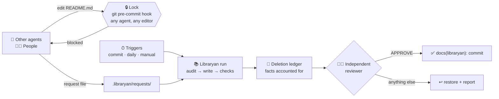

<p align="center">
  
</p>

<p align="center">
  <a href="https://github.com/narek-mn/libraryan/actions/workflows/test.yml"></a>
  <a href="https://pypi.org/project/libraryan/"></a>
  
  
  
  <a href="https://github.com/narek-mn/libraryan/blob/main/LICENSE"></a>
</p>

<p align="center">
  <b>Your AI agents write Markdown faster than anyone can keep it true.</b><br>
  Libraryan makes one agent the <b>only writer</b> of your project's docs. Every other agent, and every person, files a request.
</p>

<p align="center">
  <a href="#quick-start">Quick start</a> ·
  <a href="#how-it-works">How it works</a> ·
  <a href="#see-it-on-a-real-repo">Demo</a> ·
  <a href="#why-trust-it-with-your-docs">Safety</a> ·
  <a href="https://github.com/narek-mn/libraryan/blob/main/docs/guide.md">Guide</a>
</p>

<p align="center">
  
</p>

## The problem

Give a repo a few coding agents and a few months, and the Markdown rots:
a `README` that documents flags the code dropped, three `setup` guides that disagree, `NOTES.md`, `TODO_old.md`, an empty `ideas.md`, and agent instruction files nobody has read since they were written.
Every agent writes docs. No one owns them.

## The fix: one owner

Libraryan installs an agent that **owns every Markdown file** in your project: knowledge base, docs and agent instruction files. It is vendor-neutral where it matters: your docs stay plain Markdown in git, the rules live in `AGENTS.md` (read by Codex, Cursor, Gemini, Copilot, Claude and others), and the lock is a git hook that stops every tool alike.

- 🔒 **Single writer, enforced.** A git pre-commit hook blocks every other edit, from any agent or editor. This is a hook, not a polite prompt.
- 📨 **Everyone else files a request.** Other agents and people drop a note in `.libraryan/requests/`. Libraryan writes the change.
- 🧭 **Docs checked against the code.** When docs contradict the code, it fixes the docs and reports suspected code bugs. It never edits code.
- 🧹 **Junk removed, facts kept.** Outdated Markdown is deleted only after a *deletion ledger* proves where each fact went.
- 🧑‍⚖️ **A second agent reviews every commit.** A separate, read-only process with a fresh context. Anything but an exact `APPROVE` blocks the commit.
- 💸 **Cost caps built in.** Per-call and daily budgets, and a model-free audit that makes quiet nights cost **$0**.

## Quick start

```bash
pipx install libraryan     # once per machine
cd your-project            # any git repo, on its default branch
libraryan init             # once per project: installs, builds the KB, commits
```

That's it. From now on Libraryan updates the docs after your commits and checks them once a day. It **asks before every commit**: each run leaves a proposal you check with `libraryan review` and accept with `libraryan approve` (or turn on automatic commits). It **never pushes**. Remove it at any time with `libraryan uninstall`; the docs stay.

<details>
<summary><b>Or install as a Claude Code plugin</b></summary>

```
/plugin marketplace add narek-mn/libraryan
/plugin install libraryan@libraryan
/libraryan:init
```

`/libraryan:init` installs the CLI with pipx and runs `libraryan init`. `/libraryan:status` shows health and cost, and `/libraryan:request` files a doc change.
</details>

<details>
<summary><b>Requirements</b></summary>

Linux or macOS with:

| Need | Check | Install |
|---|---|---|
| Python 3.10+ | `python3 --version` | your package manager |
| pipx | `pipx --version` | Debian/Ubuntu: `sudo apt install pipx && pipx ensurepath`; macOS: `brew install pipx && pipx ensurepath` |
| git 2.34+ | `git --version` | your package manager |
| One agent CLI, logged in: Claude Code, Codex, Gemini, Qwen, Copilot, OpenCode or Cursor (others via a custom command) | e.g. `claude --version` | [Runtimes](https://github.com/narek-mn/libraryan/blob/main/docs/guide.md#runtimes) lists the install and login for each |
| cron | `crontab -l` | usually preinstalled |
| [gitleaks](https://github.com/gitleaks/gitleaks) (optional) | `gitleaks version` | secret scanning |
</details>

## How it works



1. **Commit as usual.** After a quiet period (10 minutes by default), Libraryan wakes up. A daily run catches anything else.
2. **Audit first, for free.** A deterministic check finds broken links, paths that no longer exist and notes older than their sources. If there is nothing to do, it stops there without calling a model.
3. **Write.** Libraryan updates the knowledge base (`docs/kb/`, with an `index.md` and a `log.md`), fixes stale docs, merges duplicates and deletes junk.
4. **Gate.** Lint, secret scan, deletion ledger, then an independent reviewer. Only fully approved runs are committed, and only Libraryan's own files.
5. **Report.** Each run leaves a report (`.libraryan/state/reports/latest.md`) and a trace line with its cost. `libraryan stats` shows the totals.

## See it on a real repo

We built a small weather CLI the way agent-heavy repos really look: a README that documents flags and an env var the code dropped, a second setup guide that disagrees with it, scratch notes, meeting notes, an old to-do list, an empty stub, and one quiet bug in the code. Then we ran `libraryan init` once. These are the real results:

<table>
<tr><th>Before: 8 loose files</th><th>After one setup run (5.6 min, $2.29)</th></tr>
<tr><td valign="top">

```
CHANGELOG-draft.md
CLAUDE.md
README.md          stale flags, wrong env var
NOTES.md
TODO_old.md
meeting-notes-2024.md
docs/ideas.md      empty "TBD"
docs/setup-old.md  disagrees with README
```

</td><td valign="top">

```
README.md          fixed against the code
AGENTS.md          project rules in one place
CLAUDE.md          -> @AGENTS.md
CHANGELOG-draft.md filled in
docs/kb/
  index.md  log.md
  api-key.md          forecast-days.md
  office-network-ssl.md  owm-api-version.md
  response-cache.md   stdlib-only.md
  units-flag.md
```

</td></tr>
</table>

- **5 junk files deleted, no fact lost.** The ledger mapped all 10 facts they held to their new homes, with quotes checked mechanically, and named the 2 files that held nothing worth keeping.
- **The README was fixed against the code**: Python version, the `WEATHER_API_KEY` env var, the `--units`/`--days`/`--json` flags, and dev setup.
- **It caught the code bug we planted** and reported it without touching the code: *"`weather_cli/cache.py:13`: `get()` returns the cached entry only when it is older than the TTL… The check is backwards."*
- **It flagged a conflict** for a human: an old `AGENTS.md` rule told agents to edit the README directly.
- **A later request** ("document the new Dockerfile") was applied in **53 s for $0.39**. Total for the day: **$2.68**, 2 commits, 0 failures, and an audit with no findings.

Rebuild the demo yourself: [`examples/demo`](https://github.com/narek-mn/libraryan/tree/main/examples/demo).

## Why trust it with your docs

| Risk | What Libraryan does |
|---|---|
| It deletes something important | A deleted doc must be a pure move, or the run must quote where each fact went. Quotes are checked mechanically, otherwise the deletion is restored. Git keeps everything. |
| It hallucinates | Every commit passes a second agent that sees the diff, not the author's reasoning, and **fails closed**. |
| It touches my code | It works in a throwaway copy of the repo; only owned docs come back. Anything else is discarded, and code issues go into the report. |
| It leaks a secret into docs | It is told never to copy secrets, and an optional gitleaks scan runs on every run. |
| It burns money | Claude Code calls get `--max-budget-usd`; other runtimes get a time limit and, where the tool has one, a turn cap. Every runtime gets daily caps on runs, commits and failure streaks. Quiet nights skip the model entirely. |
| Other agents treat a request as a command | Request files are data, never instructions. |
| I want it gone | `libraryan uninstall` removes hooks, cron and the agent in one commit. Your docs stay. |

Honest limits: non-Claude runtimes are experimental until each has had a real smoke run (see the [guide](https://github.com/narek-mn/libraryan/blob/main/docs/guide.md#runtimes)). A few runtimes cannot restrict shell commands per run. Files in the repo are protected by the throwaway copy and the owned-paths-only copy-back, and a pre-push hook blocks pushes while a run is active; but a runtime with unrestricted shell could still touch files outside the repo or run other commands, so run those only on machines and accounts you trust. Linux and macOS only. The lock is a guardrail, not a security boundary (`git commit --no-verify` skips it). See [Known limits](https://github.com/narek-mn/libraryan/blob/main/docs/guide.md#known-limits).

## Runtimes

The writer and the reviewer each run on an agent CLI. `libraryan init` picks one it finds (or use `--runtime NAME`); `libraryan runtime` shows and switches it.

| Runtime | Status | Cost in reports |
|---|---|---|
| Claude Code | stable | USD |
| Codex, Gemini, Qwen, Copilot, Cursor | experimental | unknown |
| OpenCode | experimental | USD when the tool reports it, else unknown |
| Any CLI via `runtime_command` | experimental | unknown |

## Commands

| Command | Does |
|---|---|
| `libraryan init` | Install into this repo and build the knowledge base |
| `libraryan run` | Run now |
| `libraryan status` / `review` | Is a proposal waiting, and what it would change |
| `libraryan approve` / `reject` | Commit or discard the waiting proposal |
| `libraryan runtime` | Show the agent CLIs in use and found; `libraryan runtime NAME [--reviewer]` switches |
| `libraryan audit` | Docs-vs-code audit, no model call |
| `libraryan stats` | Runs, commits, failures and cost per day |
| `libraryan check` | Lint docs and scan for secrets |
| `libraryan upgrade` | Refresh the project after `pipx upgrade libraryan` |
| `libraryan uninstall` | Remove it. The knowledge base stays |

Configuration, reports, upgrade notes and every option are in the **[guide](https://github.com/narek-mn/libraryan/blob/main/docs/guide.md)**.

## FAQ

<details><summary><b>Why not just put "keep the docs updated" in CLAUDE.md?</b></summary>

Because every agent then writes docs in its own style, at its own time, without checking them against the code. That instruction is how Markdown rot starts. Libraryan makes one writer responsible and enforces it with hooks, so the rule can't be skipped by accident.
</details>

<details><summary><b>What does it cost?</b></summary>

You pay for your own model usage. A run happens only after commits, on request, or when the daily audit finds something. Quiet days are free. On Claude Code, hard caps apply per call (default $5 for a run, $25 for the first setup); other runtimes are bounded by a time limit and, where the tool has one, a turn cap. Daily caps apply to every runtime. `libraryan stats` shows the real spend.
</details>

<details><summary><b>Does it work with Cursor, Copilot, Gemini or Codex agents?</b></summary>

Yes. The git pre-commit hook rejects any tool's commits to owned docs, the request rules are written into `AGENTS.md`, which those agents read, and the knowledge base is plain Markdown any model can use. Libraryan's own writer and reviewer run on Claude Code, Codex, Gemini, Qwen, Copilot, OpenCode or Cursor (or any CLI through a custom command); the non-Claude ones are experimental until smoke-tested.
</details>

<details><summary><b>Will it push or open PRs?</b></summary>

No. By default it does not even commit without you: `libraryan approve` commits a proposal locally, on your default branch, under its own `docs(libraryan):` prefix. You decide when to push.
</details>

<details><summary><b>Can my teammates still change docs?</b></summary>

Yes, by filing a request: a short Markdown file under `.libraryan/requests/`. Their agents learn how from the `libraryan-request` skill and `AGENTS.md`. You can also exempt paths in the config.
</details>

## Contributing

Issues and PRs are welcome. Start with [CONTRIBUTING.md](https://github.com/narek-mn/libraryan/blob/main/CONTRIBUTING.md). Report security issues privately ([SECURITY.md](https://github.com/narek-mn/libraryan/blob/main/SECURITY.md)).

If Libraryan keeps your docs honest, a ⭐ helps others find it.

<sub>MIT © narek-mn · [Changelog](https://github.com/narek-mn/libraryan/blob/main/CHANGELOG.md)</sub>
